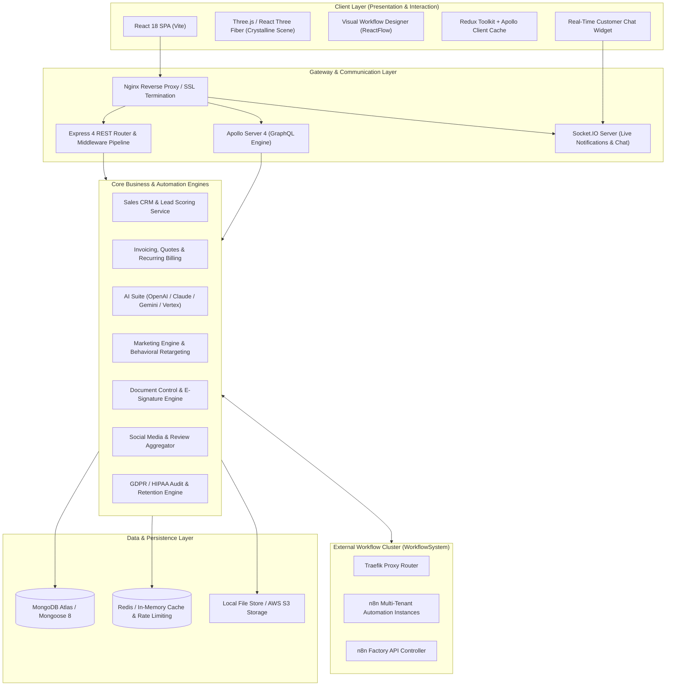

# ERP.js  -  The Automation Engine for Modern Teams

<div align="center">

[](https://github.com/Overproness/ERP.js)
[](https://nodejs.org)
[](https://www.typescriptlang.org)
[](https://react.dev)
[](https://vitejs.dev)
[](https://graphql.org)
[](https://www.mongodb.com)
[](https://socket.io)
[](https://threejs.org)
[](https://tailwindcss.com)

<p align="center">
  <b>A unified, developer-centric, full-stack ERP, CRM, and Multi-Agent AI Automation Platform.</b><br/>
  Engineered with high-contrast glassmorphism, reactive real-time WebSockets, visual workflow graphs, multi-channel marketing, and enterprise compliance.
</p>

[**Explore Features**](#core-capabilities--functional-modules) •
[**System Architecture**](#system-architecture) •
[**Quick Start**](#getting-started) •
[**Tier Matrix**](#saas-tier-access-matrix) •
[**API & GraphQL**](#api-and-graphql-integration) •
[**Design System**](#the-crystalline-engine-design-system)

---

</div>

## Executive Overview

**ERP.js** is a next-generation enterprise resource planning and business automation platform engineered for high-growth businesses and developer-led organizations. Moving away from rigid, legacy, and fragmented business software, ERP.js converges:

1. **Intelligent Sales CRM & Financial Billing**  -  Lead scoring, customer journeys, touchpoints, quotes, invoicing, recurring billing, and automated tax accounting.
2. **Multi-Provider AI Intelligence**  -  Integrations with OpenAI (GPT-4), Anthropic (Claude), Google (Gemini / Vertex AI), Azure OpenAI, and Hugging Face for context-aware assistance, automated document OCR, and self-learning feedback loops.
3. **Visual Workflow Automation Engine**  -  Native ReactFlow drag-and-drop workflow canvas (15+ node types) combined with self-hosted enterprise **n8n** orchestration and Traefik container clustering.
4. **Behavioral Marketing & Omnichannel Engagement**  -  Event-driven retargeting, multi-channel broadcast (Email/SMS/Push), split URL & campaign A/B testing, and real-time click attribution.
5. **Unified Social Media & Brand Reputation**  -  Multi-platform publishing (Facebook, Twitter/X, Instagram), Google & Facebook review aggregation, sentiment classification, and automated AI response drafting.
6. **Live Communication & Dynamic Interaction**  -  WebSocket live customer chat with agent queues, URL shortener with geo/device analytics, and dynamic public surveys.
7. **Document Lifecycle & Enterprise Compliance**  -  Collaborative rich-text editor, revision history, cryptographic E-Signatures, GDPR/HIPAA compliance validator, and automated data retention policies.
8. **Multi-Tenant SaaS Licensing**  -  Dynamic 3-tier subscription gating (Starter, Professional, Enterprise) enforced at both GraphQL/REST API middleware and React UI layers.

---

## System Architecture

ERP.js is structured as a decoupled full-stack monorepo featuring a high-throughput Node.js/Express/Apollo backend, a reactive React 18 single-page application powered by Vite, and a dedicated containerized workflow orchestration cluster.



---

## Core Capabilities & Functional Modules

### 1.  Sales CRM & Pipeline Intelligence
Full customer lifecycle management from lead acquisition to revenue realization.
- **Client & Contact Directory:** Comprehensive CRUD operations, custom metadata, lifecycle statuses, communication history, and contact segmentation.
- **5-Factor Weighted Lead Scoring:** Dynamically computes lead quality using:
  - *Demographic fit (20%)*
  - *Behavioral activity (25%)*
  - *Engagement frequency (25%)*
  - *Deal estimated value (20%)*
  - *Expressed interest signals (10%)*
- **Customer Journey Mapping:** Visualizes and tracks granular customer touchpoints across sales, support, and marketing touchpoints in real-time.
- **Interaction & Activity Logging:** Centralizes meeting notes, call summaries, email threads, and task delegation per account.
- **Automated Follow-Up Engine:** Event-triggered and schedule-based follow-up task generation.
- **Integrated Appointment Scheduling:** Calendar booking with timezone alignment, status lifecycle (scheduled, completed, cancelled), and CRM association.

### 2.  Invoicing, Quotes & Financial Control
Comprehensive billing automation built to handle modern SaaS and service-based models.
- **Interactive Invoicing:** Create, edit, and send professional invoices with line items, dynamic discounts, and customizable tax rules.
- **Quotes & Proposals:** Draft and dispatch quotes with bulk delivery capabilities (`quoteDeliveryService`) and **one-click conversion into invoices**.
- **Multi-Mode Payment Recording:** Support for Cash, Bank Wire, Credit/Debit Cards, PayPal, Stripe, and custom payment gateways.
- **Recurring Billing & Subscriptions:** Automated cycle re-billing, recurring invoice generation, and status management (trialing, active, past-due, cancelled).
- **Server-Side PDF Generation:** Automated high-resolution PDF rendering for invoices and quotes using HTML-to-PDF, PDFKit, and pdf-lib.
- **Tax Management:** Granular jurisdiction tax definitions applied per line-item or per transaction.

### 3.  Multi-Provider AI Suite & Cognitive Intelligence
Pluggable, multi-provider generative intelligence running across every business module.
- **Multi-Provider LLM Integration:** Switch seamlessly or route requests across:
  - **OpenAI:** GPT-4, GPT-4o, GPT-3.5-Turbo
  - **Anthropic:** Claude 3.5 Sonnet / Haiku
  - **Google:** Gemini 1.5 Pro / Flash via Google Generative AI & Vertex AI
  - **Azure OpenAI & Hugging Face**
- **Context-Aware Prompts:** Enriches prompts with live customer, financial, and operational records from the MongoDB database (`contextAwareService.ts`).
- **AI Knowledge Base:** Upload, index, and query company-specific documentation for contextual retrieval in assistant sessions.
- **AI Self-Learning Feedback Loop:** Automatically analyzes operator feedback and user interactions (`AILearningData`) to continuously fine-tune assistant accuracy via scheduled background jobs.
- **Automated Document OCR & Data Extraction:** Extracts clean, structured data from receipts, invoices, and scans using `Tesseract.js` with fallback to multimodal AI Vision.
- **Predictive Analytics:** ML-driven churn prediction, deal closing probability scoring, and sales revenue projections.
- **Global Copilot Module:** Floating omni-present conversational workspace assistant accessible anywhere inside the application.

### 4.  Visual Workflow Automation Engine
End-to-end event-driven orchestration combining an in-house visual canvas with enterprise n8n power.
- **Drag-and-Drop Node Canvas:** ReactFlow-powered interactive designer (`WorkflowDesigner.tsx`) supporting 15+ node types:
  - *Trigger* • *Webhook* • *HTTP Request* • *Condition / If-Else* • *Delay*
  - *Data Transform* • *Email Delivery* • *Database Query* • *Custom Script (VM2 sandbox)*
  - *Notification* • *File Operation* • *Data Validation* • *Loop* • *Split & Merge*
- **Execution Tracking & Debugging:** Visual execution history showing execution latency, input/output state, and error logs per node.
- **Behavioral Trigger Rule Engine:** Event-driven listener that reacts to client milestones, payments, or marketing interactions.
- **Automated Cron Scheduler:** Distributed background cron scheduler for recurring tasks, periodic sweeps, and deadline reminders (`reminderScheduler.ts`).
- **Enterprise n8n Cluster Integration:** Built-in bridge to a dedicated multi-tenant n8n factory running behind a Traefik load balancer for advanced enterprise ETL pipelines.

### 5.  Behavioral Marketing & Omnichannel Campaigns
Sophisticated marketing automation driven by real-time customer behavior.
- **Visual Campaign Builder:** Drag-and-drop multi-stage campaign sequence builder.
- **Omnichannel Dispatch:** Native support for bulk personalized Email (SendGrid, Resend, Nodemailer/SMTP), SMS (Twilio), and Web Push notifications.
- **Customer Behavioral Event Tracking:** Tracks web page visits, item views, cart activity, and checkout drop-offs (`BehaviorProcessor.ts`).
- **Intelligent Retargeting Engine:** Automatically activates recovery campaigns when customer inactivity or cart abandonment is detected (`RetargetingEngine.ts`).
- **Campaign A/B Testing:** Multi-variant split testing for message templates, subject lines, and URLs with statistical winner calculation.
- **AI-Powered Campaign Optimization:** Machine learning suggestions for optimal send times, automated subject line generation, and copy variants (`AIOptimizer.ts`).

### 6.  Social Media Publishing & Reputation Management
Unified social presence and automated online reputation governance.
- **Multi-Platform Social Publishing:** Direct scheduling and cross-posting to Facebook, Twitter/X (API v2), and Instagram.
- **AI Social Content Generator:** Generates engaging captions, target audience hashtags, and creative post variations (`socialAIService.ts`).
- **Social Mention & Brand Listening:** Continuous background monitoring for brand mentions and keyword alerts.
- **Multi-Source Review Aggregator:** Pulls verified reviews automatically from Google Reviews and Facebook Pages.
- **Sentiment Classification:** Real-time sentiment scoring (positive, neutral, negative) on incoming customer feedback.
- **AI Auto-Response Generation:** One-click AI drafting of tailored, polite responses to reviews based on customer sentiment and rating.
- **Public Reputation Portal:** Branded, public-facing portal showcasing verified client testimonials and high-rating reviews.

### 7.  Live Customer Communication & URL Tracking
Modern communication tools designed for seamless customer acquisition and support.
- **Embeddable Customer Live Chat:** Lightweight, branded embeddable chat widget (`chatSocket.ts`) communicating over real-time WebSockets.
- **Intelligent Chat Queuing:** Agent routing, queue wait-time estimation, and chat history archival (`chatQueueService.ts`).
- **URL Shortener & Attribution Tracker:** Generate branded short URLs with custom alias support, password gating, and QR codes.
- **Deep Click Analytics:** Granular visitor insights including:
  - *Geo-location resolution (Country, City, Region via `geoip-lite`)*
  - *Client platform, browser, and device classification via `ua-parser-js`*
  - *Full UTM campaign attribution and referrers*
- **Dynamic Survey Builder:** Design multi-question surveys with single/multi-choice, rating, and free-text prompts, with public unauthenticated submission links and completion funnels.

### 8.  Document Control, E-Signatures & Compliance
Enterprise-grade document lifecycle governance with strict regulatory alignment.
- **Rich Document Editor:** Collaborative rich-text editor supporting formatting, embedded media, and template re-use.
- **Revision History & Version Control:** Immutable document snapshots with side-by-side version comparison (`DocumentVersion.ts`).
- **Cryptographic E-Signatures:** Legally compliant digital signature capture, timestamping, and tamper verification.
- **Regulatory Compliance Validation:** Built-in compliance checks for GDPR, HIPAA, and custom company policies (`DocumentCompliance.ts`).
- **GDPR Privacy & Consent Suite:** Consent opt-in/opt-out audit trail (`consentRecordModel.ts`), automated data retention schedules, and one-click data export / right-to-erasure workflows.
- **Platform-Wide Audit Logging:** Tamper-evident logging of administrative actions, credential changes, and data access records (`auditTrailModel.ts`).

---

## "The Crystalline Engine" Design System

ERP.js introduces **The Crystalline Engine** (also known as *The Technical Prism*), an editorial design system engineered for high-density information architecture without visual clutter:

<div align="center">
  <table>
    <tr>
      <td align="center" width="25%"><b>Tonal Layering</b><br/>No 1px solid section borders. Structure is formed purely by subtle surface shifts (#f8f9fa &rarr; #f3f4f5 &rarr; #ffffff).</td>
      <td align="center" width="25%"><b>Glassmorphism</b><br/>Floating overlays, modals, and dropdowns feature 70-80% opacity with 12px–20px backdrop blurs and subtle glass strokes.</td>
      <td align="center" width="25%"><b>Electric Blue Accent</b><br/>High-energy conductive gradient (<code>#0058c3</code> &rarr; <code>#0070f3</code> at 135°) highlights interactive pathways and primary CTAs.</td>
      <td align="center" width="25%"><b>Three.js 3D Canvas</b><br/>Interactive, performant 3D isometric crystal scenes built with React Three Fiber, Drei, and post-processing shaders.</td>
    </tr>
  </table>
</div>

- **Typography:** Strict typographic hierarchy using the **Inter** font family, utilizing tight tracking (`-0.02em`) on bold headers and uppercase label chips for metadata.
- **High-Density Data Tables:** Powered by `@tanstack/react-table` with row hover states and no horizontal divider clutter.
- **Interactive Visualizations:** Integrated charts using `@nivo` (Bar, Line, Pie), `recharts`, and `chart.js`.

---

## SaaS Tier Access Matrix

ERP.js includes native multi-tenant subscription gating configured via `backend/src/config/featureMap.ts` and enforced on the frontend through `<PlanGating />`:

| Feature & Module Capability | Starter Tier | Professional Tier | Enterprise Tier |
| :--- | :---: | :---: | :---: |
| **User Seats & Accounts** | Up to 10 Users | Up to 50 Users | **Unlimited** |
| **Workflow Rules Limit** | 10 Active Rules | Unlimited | **Unlimited** |
| **Core CRM & Invoicing** | Included | Included | Included |
| **Quotes & Recurring Billing** | Basic | Advanced | Enterprise |
| **E-Signatures on Documents** |  -  | Included | Included |
| **AI Assistant & Copilot (Base)** |  -  | Included | Included |
| **AI Knowledge Base & Semantic Indexing** |  -  |  -  | **Included** |
| **AI Anomaly & Fraud Detection** |  -  |  -  | **Included** |
| **AI Self-Learning Optimization Loop** |  -  |  -  | **Included** |
| **Multi-Channel Marketing Campaigns** |  -  | Included | Included |
| **Behavioral Retargeting & A/B Testing** |  -  | Included | Included |
| **Social Media Scheduler** |  -  | Included | Included |
| **Social Mention Monitoring** |  -  |  -  | **Included** |
| **Review Aggregation & AI Responses** |  -  |  -  | **Included** |
| **Reputation Public Portal** |  -  |  -  | **Included** |
| **Global Analytics & Real-Time KPIs** |  -  | Included | Included |
| **Custom Report Builder & Data Export** |  -  |  -  | **Included** |
| **Visual Workflow Designer** |  -  | Included | Included |
| **n8n Containerized Orchestration** |  -  |  -  | **Included** |
| **Customer Live Chat & Agent Queue** |  -  | Included | Included |
| **GDPR Consent, Retention & Audit Trail** | Basic | Advanced | **Enterprise Full** |
| **SSO / SAML Authentication** |  -  |  -  | **Included** |
| **Custom White-Label Branding** |  -  |  -  | **Included** |
| **Full REST & GraphQL API Access** | Read-Only | Full Access | Full Access |
| **Outbound Webhooks Engine** |  -  |  -  | **Included** |

---

## Technology Stack Breakdown

<div align="center">
  <table>
    <thead>
      <tr>
        <th>Layer</th>
        <th>Technologies</th>
      </tr>
    </thead>
    <tbody>
      <tr>
        <td><b>Backend Runtime & API</b></td>
        <td><code>Node.js 20.9.0</code>, <code>TypeScript 5.9</code>, <code>Express.js 4.18</code>, <code>Apollo Server 4 (GraphQL)</code>, <code>Socket.IO 4.8</code></td>
      </tr>
      <tr>
        <td><b>Database & Persistence</b></td>
        <td><code>MongoDB Atlas</code>, <code>Mongoose 8.1</code>, <code>Redis 5.7</code>, <code>Rate-Limit Mongo/Redis</code></td>
      </tr>
      <tr>
        <td><b>Frontend Architecture</b></td>
        <td><code>React 18.3</code>, <code>Vite 5.4</code>, <code>TypeScript</code>, <code>Redux Toolkit</code>, <code>Apollo Client 4</code>, <code>React Router 6</code></td>
      </tr>
      <tr>
        <td><b>UI, Styling & 3D</b></td>
        <td><code>Tailwind CSS 3.4</code>, <code>Three.js</code>, <code>React Three Fiber</code>, <code>Drei</code>, <code>Radix UI</code>, <code>Material UI</code>, <code>Lucide Icons</code></td>
      </tr>
      <tr>
        <td><b>Workflows & Builders</b></td>
        <td><code>ReactFlow 11</code>, <code>n8n</code>, <code>Traefik</code>, <code>VM2 Sandbox</code></td>
      </tr>
      <tr>
        <td><b>AI & Machine Learning</b></td>
        <td><code>OpenAI SDK</code>, <code>Anthropic SDK</code>, <code>Google Generative AI</code>, <code>Tesseract.js OCR</code>, <code>NLP.js</code></td>
      </tr>
      <tr>
        <td><b>Data Processing & Media</b></td>
        <td><code>PDFKit</code>, <code>pdf-lib</code>, <code>html-pdf</code>, <code>XLSX</code>, <code>csv-parser</code>, <code>Mammoth</code>, <code>Cheerio</code>, <code>QRCode</code></td>
      </tr>
      <tr>
        <td><b>Communication Transports</b></td>
        <td><code>Nodemailer</code>, <code>Resend</code>, <code>Twilio SDK</code>, <code>SendGrid</code>, <code>Socket.IO WebSockets</code></td>
      </tr>
      <tr>
        <td><b>Testing & Quality</b></td>
        <td><code>Vitest</code>, <code>Testing Library</code>, <code>ESLint</code>, <code>TypeScript Check (noEmit)</code>, Custom Model Smoke Tests</td>
      </tr>
      <tr>
        <td><b>DevOps & Deployment</b></td>
        <td><code>Docker</code>, <code>PM2</code>, <code>Nginx</code>, <code>GitHub Actions CI/CD</code>, <code>Vercel</code></td>
      </tr>
    </tbody>
  </table>
</div>

---

## Repository Directory Structure

```
ERPjs_project/
├── backend/                         # Backend Application (Node.js + TypeScript + Express)
│   ├── src/
│   │   ├── app.ts                   # Express application setup, middlewares & routes
│   │   ├── server.ts                # HTTP, Socket.IO & MongoDB connection bootstrap
│   │   ├── config/                  # AI settings, channel config, feature gating & triggers
│   │   ├── controllers/             # REST API controllers (50+ domain controllers)
│   │   │   ├── appControllers/      # CRM, Billing, AI, Marketing, Social, Workflows
│   │   │   └── coreControllers/     # Auth, User, Admin, Setup & System Settings
│   │   ├── graphql/                 # Apollo Server 4 GraphQL schema, resolvers & types
│   │   │   ├── typeDefs/            # 45+ modular GraphQL type definition files
│   │   │   └── resolvers/           # GraphQL query & mutation resolvers
│   │   ├── middlewares/             # JWT auth, plan gating, rate limiters, validation
│   │   ├── models/                  # Mongoose domain models (60+ schemas)
│   │   │   ├── appModels/           # Business entities (Clients, Invoices, Workflows, etc.)
│   │   │   └── coreModels/          # Core entities (CompanyOwner, User, Setting)
│   │   ├── services/                # Business logic services (AI, Retargeting, Scoring, OCR)
│   │   ├── sockets/                 # Socket.IO handlers (live customer chat & notifications)
│   │   └── setup/                   # Database seeding and default configurations
│   ├── .env.example                 # Backend environment variable template
│   └── package.json                 # Backend dependencies & automation scripts
│
├── frontend/                        # Frontend Application (React 18 + Vite + Tailwind)
│   ├── src/
│   │   ├── App.tsx                  # React application entry point & context providers
│   │   ├── components/              # Reusable UI components (Crystalline glass, 3D scenes)
│   │   ├── pages/                   # Application views & dashboards (35+ full modules)
│   │   │   ├── AIAssistant/         # Conversational assistant & prompt interfaces
│   │   │   ├── Analytics/           # Global KPIs, cross-module analytics & reports
│   │   │   ├── Customer/            # CRM clients, contacts & customer journey tracking
│   │   │   ├── Document/            # Rich-text editor, e-signatures & compliance
│   │   │   ├── Invoice/             # Invoice creation, status tracking & payment capture
│   │   │   ├── marketing/           # Visual Campaign Builder & behavioral retargeting
│   │   │   ├── Reputation/          # Review aggregation & AI sentiment responses
│   │   │   ├── SocialMedia/         # Social accounts, scheduling & analytics
│   │   │   ├── Surveys/             # Survey builder & response analysis
│   │   │   ├── URL/                 # URL shortener, QR codes & click attribution
│   │   │   ├── Website/             # High-impact marketing landing pages (Crystalline)
│   │   │   └── WorkflowBuilder/     # ReactFlow drag-and-drop workflow canvas
│   │   ├── redux/                   # Redux Toolkit state slices & store configuration
│   │   ├── router/                  # Protected routes, plan-based gating & lazy loaders
│   │   └── style/                   # Tailwind CSS styling, themes & glass tokens
│   ├── .env                         # Frontend local environment config
│   ├── .env.production              # Frontend production environment config
│   └── package.json                 # Frontend dependencies & build scripts
│
├── WorkflowSystem/                  # Enterprise Workflow Orchestration
│   ├── n8n/                         # Self-hosted n8n engine fork & enterprise packages
│   └── n8n-factory/                 # Multi-instance dynamic n8n container orchestrator
│       ├── api-controller/          # Factory API controller & Docker Compose definitions
│       └── traefik/                 # Traefik load balancer & reverse proxy configuration
│
├── .github/workflows/deploy.yml     # Automated VPS CI/CD deployment pipeline via SSH & PM2
├── codegen.ts                       # Apollo GraphQL TypeScript code generation config
├── docker-compose.yml               # Multi-container orchestration (Mongo, Redis, API, UI)
├── .env.example                     # Root production environment configuration template
├── DEVELOPER_ACCOUNTS_SETUP_GUIDE.md# BYOC step-by-step API integration guide
├── MARKETING_INTEGRATION_PLAN.md    # Architecture and progress roadmap
└── vercel.json                      # Vercel deployment and SPA routing rewrite rules
```

---

## Getting Started

### 1-Command Docker Compose Quickstart (Recommended)

The fastest and most reliable way to spin up the entire ERP.js stack (MongoDB, Redis, Node.js API, and Nginx frontend) is via Docker Compose:

```bash
# 1. Clone the repository
git clone https://github.com/Overproness/ERP.js.git ERPjs
cd ERPjs

# 2. Copy the environment configuration template
cp .env.example .env

# 3. Start all services in detached mode
docker compose up -d --build
```

Once running:
- **Web Application:** `http://localhost`
- **Backend REST & GraphQL API:** `http://localhost:8888`
- **GraphQL Playground:** `http://localhost:8888/graphql`

---

### Bring Your Own Credentials (BYOC) Architecture

ERP.js follows a **100% Bring Your Own Credentials (BYOC)** model, similar to self-hosted platforms like n8n or Supabase.

1. **Zero Mandatory Corporate Developer Accounts:**  
   You do not need to register complex commercial developer accounts to evaluate the platform. Out of the box, ERP.js operates in **Sandbox / Simulation Mode**.
2. **Realistic Simulation Telemetry:**  
   On public demos or local tests without API keys, advertising metrics, conversion events, post analytics, and customer reviews render realistically with synthetic telemetry.
3. **Live Production Upgrades:**  
   When you wish to publish live social posts, stream real conversions, run Meta/Google/TikTok ad campaigns, or manage real Google Business reviews, simply input your own API keys in the Settings UI or `.env` file. All secrets are envelope-encrypted at rest using **AES-256-GCM**.
4. **Step-by-Step Platform Guides:**  
   Detailed credential setup instructions for every supported platform are available in [DEVELOPER_ACCOUNTS_SETUP_GUIDE.md](DEVELOPER_ACCOUNTS_SETUP_GUIDE.md).

---

### Manual Local Development Setup

### Prerequisites

Ensure you have the following installed on your host machine:
- **Node.js:** `v20.9.0` or higher
- **npm:** `v10.2.4` or higher
- **MongoDB:** A local MongoDB instance or a [MongoDB Atlas](https://www.mongodb.com/atlas) cluster URI
- **Git**

---

### Step 1: Clone the Repository

```bash
git clone https://github.com/Overproness/ERP.js.git ERPjs
cd ERPjs
```

---

### Step 2: Configure & Launch Backend

1. Navigate to the backend directory:
   ```bash
   cd backend
   ```

2. Install dependencies:
   ```bash
   npm install
   ```

3. Create your `.env` configuration file:
   ```bash
   cp .env.example .env
   ```

4. Edit `.env` with your primary settings:
   ```env
   PORT=8888
   NODE_ENV=development
   DATABASE=mongodb+srv://<user>:<password>@cluster.mongodb.net/erpjs?retryWrites=true&w=majority
   JWT_SECRET=your_super_secret_jwt_key_at_least_32_characters
   PUBLIC_SERVER_FILE=http://localhost:8888/
   FRONTEND_URL=http://localhost:3000

   # AI Provider Keys (Optional but recommended)
   OPENAI_API_KEY=your_openai_api_key
   CLAUDE_API_KEY=your_anthropic_api_key

   # SMTP Email Configuration
   SMTP_HOST=smtp.gmail.com
   SMTP_PORT=587
   SMTP_USER=your_email@gmail.com
   SMTP_PASSWORD=your_app_password
   SMTP_FROM_EMAIL=your_email@gmail.com
   ```

5. Seed the database with default administrator accounts and system settings:
   ```bash
   npm run setup
   ```

6. Start the backend development server:
   ```bash
   npm run dev
   ```
   >  The backend will start on **`http://localhost:8888`**  
   >  GraphQL Playground / Endpoint available at **`http://localhost:8888/graphql`**

---

### Step 3: Configure & Launch Frontend

1. Open a new terminal and navigate to the frontend directory:
   ```bash
   cd frontend
   ```

2. Install dependencies:
   ```bash
   npm install
   ```

3. Verify or create `.env`:
   ```env
   VITE_BACKEND_SERVER=http://localhost:8888/
   VITE_API_URL=http://localhost:8888
   VITE_FILE_BASE_URL=http://localhost:8888/
   VITE_FRONTEND_URL=http://localhost:3000/
   ```

4. Start the Vite development server:
   ```bash
   npm run dev
   ```
   >  The frontend interface will launch on **`http://localhost:3000`**

---

### Step 4: Sign In with Default Credentials

Once the database is seeded using `npm run setup`, you can authenticate immediately:

| Field | Value |
| :--- | :--- |
| **Default Admin Email** | `admin@demo.com` |
| **Default Password** | `@Admin123` |
| **Role** | Organization Owner (`CompanyOwner`) |

---

## API and GraphQL Integration

ERP.js offers a hybrid **GraphQL (Apollo Server 4)** and **RESTful Express** architecture:

### 1. Apollo GraphQL API (`/graphql`)
The primary data fetching layer for queries, mutations, and deep entity graphs.
- **Type Definitions:** Located in `backend/src/graphql/typeDefs/` (45+ domain definitions).
- **TypeScript Code Generation:** Automatic type generation from `.graphql` queries via `@graphql-codegen`:
  ```bash
  # Run from root
  npx graphql-codegen --config codegen.ts
  ```

### 2. Selective REST Endpoints
Dedicated endpoints for binary streams, file uploads, third-party webhooks, and public routes:
- `POST /api/login` & `POST /api/logout`  -  Authentication
- `POST /api/client/create`, `GET /api/client/list`  -  Entity CRUD endpoints
- `POST /api/pdf/invoice`  -  Dynamic PDF invoice download
- `POST /api/upload`  -  Multipart document uploads via `express-fileupload`
- `GET /url/:shortCode`  -  Dynamic link redirection with geo-tracking
- `POST /api/webhook/social`  -  Webhook receivers for social media platforms

---

## Testing & Quality Assurance

The codebase includes verification checks, model smoke tests, and frontend test suites:

### Backend Quality Commands
```bash
cd backend

# Run comprehensive smoke tests (Model integrity + ESM loaders + App startup)
npm run test:smoke

# Run full marketing regression suite (BYOC, CAPI, Audiences, Ads, Reputation)
npm run test:marketing:regression

# Run Playwright Chromium E2E browser test
npm run test:marketing:e2e

# Run all marketing verification phases (1 to 6)
npm run test:marketing:all

# TypeScript compilation check (no emit)
npm run typecheck

# Code formatting & linting
npm run lint
npm run lint:fix
```

### Frontend Quality Commands
```bash
cd frontend

# Run unit and component tests with Vitest
npm run test

# Launch Vitest interactive UI
npm run test:ui

# Verify production bundle build
npm run build
```

---

## Deployment & DevOps

### 1. Automated VPS CI/CD via GitHub Actions
A production deployment pipeline is included in [`.github/workflows/deploy.yml`](.github/workflows/deploy.yml). Pushing to the `main` branch automatically:
1. Connects to your production VPS over SSH.
2. Pulls the latest changes from `main`.
3. Rebuilds and restarts the backend process under **PM2**.
4. Builds the React frontend via Vite.
5. Deploys optimized static assets to `/var/www/erp` and reloads **Nginx**.

### 2. Vercel Frontend Deployment
A configured [`vercel.json`](vercel.json) allows zero-configuration deployment of the frontend to Vercel with single-page application (SPA) client routing rewrites.

### 3. Production Docker & Container Deployment
For containerized self-hosting, ERP.js includes multi-stage container configurations for production deployment with Docker Compose:
```bash
docker compose up -d
```

---

## Security & Enterprise Compliance

- **Authentication:** Salted hash passwords using `bcryptjs` (12 rounds) and signed `jsonwebtoken` (JWT) cookies & bearer headers.
- **Access Control:** Multi-tier role permissions separating `CompanyOwner`, `Admin`, and `User`.
- **Rate Limiting:** Distributed brute-force protection using `express-rate-limit` with Redis and MongoDB backends.
- **Input Sanitization:** Payload validation via `Joi` and `validator`, preventing NoSQL injection and XSS exploits.
- **CORS & Headers:** Dynamic origin allowlist with security headers via `helmet` and `compression`.
- **GDPR & HIPAA:** Cryptographic e-signatures, immutable audit logs, user data export, and right-to-erasure workflows.

---

## Contributing

We welcome community contributions! Please follow these steps:

1. **Fork the Repository** on GitHub.
2. **Create a Feature Branch:** `git checkout -b feature/amazing-feature`.
3. **Commit your changes:** `git commit -m 'feat: Add amazing feature'`.
4. **Run Smoke Tests:** Ensure `npm run test:smoke` passes in `backend/` and `npm run build` passes in `frontend/`.
5. **Push to Branch:** `git push origin feature/amazing-feature`.
6. **Open a Pull Request** with a detailed summary of your changes.

---

## License

ERP.js is released under the **AGPL-3.0 License** (or optional Enterprise Commercial License).  
See the [`LICENSE`](LICENSE) file for complete details.

---

<div align="center">
  <sub>Built with precision by the ERP.js Core Engineering Team. Powered by the Crystalline Engine.</sub>
</div>
